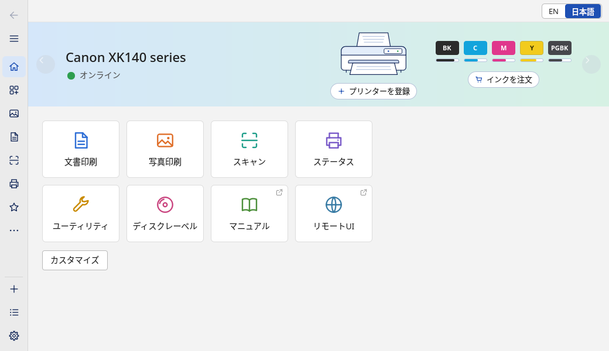
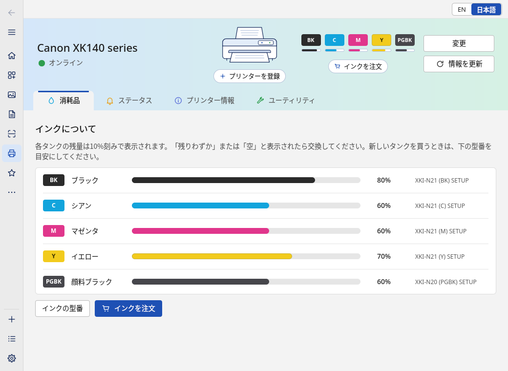
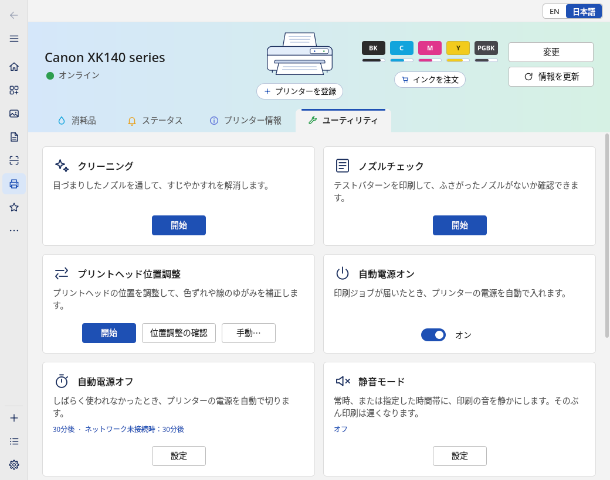
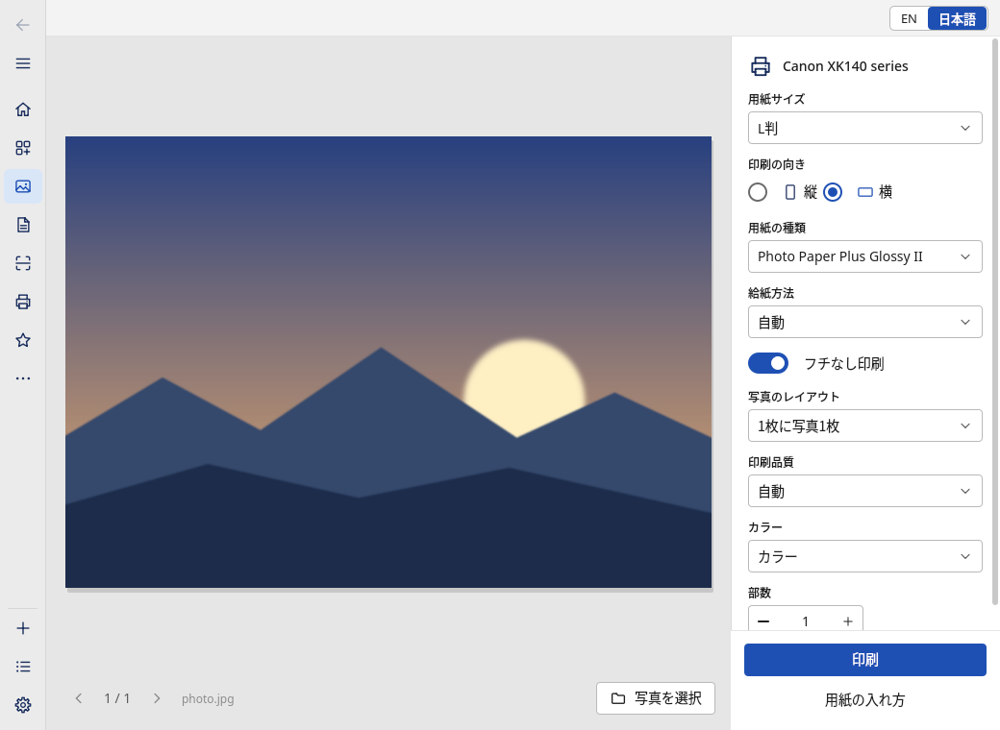
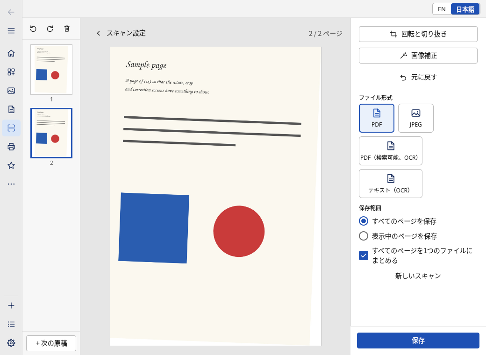
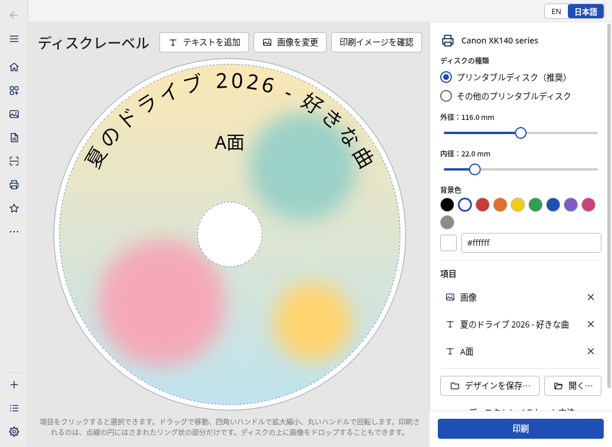

# Washi 和紙

[](https://github.com/Jenari-Dev/washi/actions/workflows/ci.yml)

[English](README.md) · **日本語**

Washi は、Canon 製インクジェットプリンターを Linux から扱うためのアプリです。プリンターの状態やインク残量の確認、
メンテナンス、各種設定、写真や書類の印刷、スキャン、ディスクレーベルの作成ができます。Canon が他の環境向けに
提供している「Canon PRINT」アプリに相当する機能を、Linux で使えるようにするのがねらいです。Canon のドライバーも
クラウドのアカウントも使わず、同じネットワーク上のプリンターと直接通信します。

> **Washi は個人による非公式のプロジェクトです。** キヤノン株式会社とは関係がなく、同社の承認や後援を受けて
> いません。Canon、PIXUS、PIXMA、Canon PRINT はキヤノン株式会社の商標で、ここでは対応するプリンターを示す
> ためだけに使っています。詳しくは [NOTICE.md](NOTICE.md) をご覧ください。

| | |
|---|---|
|  |  |
|  |  |
|  |  |

<sub>スクリーンショットは Washi 付属の疑似プリンターに接続して作成したもので、プリンター名やインク残量は
見本のデータです。画面は英語でも表示できます（[英語版のスクリーンショット](README.md)）。</sub>

## できること

- **状態とインク残量**：オンライン、スリープ中、オフラインの区別、タンクごとのインク残量と型番、給紙トレイの用紙、
  プリンター情報（ファームウェア、接続方法、印刷枚数や交換回数）を表示します。プリンターがサポート番号を
  返したときは、短い説明とヘルプページへのボタンを出します。自動電源オフで休んでいるプリンターは、起こさずに
  状態を読み取ります。
- **メンテナンス**：クリーニング、強力クリーニング、ノズルチェック、プリントヘッド位置調整（自動、確認用シート、
  値を手で入力する方法）に対応します。機種によってはローラークリーニングや底板クリーニングも使えます。
  実行中は進み具合が表示され、途中で中止することもできます。
- **設定**：静音モード（時間帯の指定も可）、自動電源オン・オフ、インク乾燥時間、用紙の間隔、ファームウェアの
  自動更新。変更するたびに、プリンターが受け付ける値かどうかを確かめ、書き込んだあとに読み戻して確認します。
- **印刷**：写真（JPEG、PNG、BMP）はフチなし印刷に対応し、用紙の種類や給紙元はプリンター自身が持つ一覧から
  選びます。1 枚の用紙に 1〜16 枚を並べる割り付けもできます。PDF 書類（LibreOffice があれば Office ファイルも）は
  ページ指定と両面印刷に対応します。プレビューには印刷結果とほぼ同じ紙面が表示され、ファイルはドラッグ＆ドロップ
  でも追加できます。
- **スキャン**：原稿台から書類や写真を読み取ります。複数ページの連続スキャン、回転、切り抜き、傾き補正、
  色の補正、原稿の自動切り抜き、複数写真の一括切り抜き、大きな原稿を 2 回に分けて読み取ってつなぐ機能、
  PDF や JPEG での保存、Tesseract があれば文字認識（OCR）も使えます。
- **ディスクレーベル**：印刷できるリング状の範囲に合わせて、画像、文字、背景色を配置できます。リングに沿って
  並ぶ文字にも対応し、プリンターへ送る画像をプレビューで確認してから、ディスクトレイで印刷します。
- **プリンター自身の用紙名と画像**：用紙の種類は、プリンターが自分で付けている名前で、使っている言語に合わせて
  表示します（日本語・英語のスイッチですぐに切り替わります）。バナーとプリンター一覧には、プリンターが公開している
  製品画像も表示します。どちらもプリンターが提供していれば、プリンターから読み取って（IPP Everywhere の
  `printer-strings-uri` と `printer-icons`）キャッシュに保存します。提供がない場合は Washi 自身の名前と絵を使います。
  `~/.local/share/washi/printers/` に自分で用意した画像があれば、それを最優先で使います。
- **通知**：バックグラウンドのサービス（`washid`）が、インクが少なくなったときや空になったとき、プリンターが
  エラーを出したとき、プリンターがまたつながったときにデスクトップ通知でお知らせします。
- **日本語と英語**：アプリ本体、通知、デスクトップエントリが両方の言語に対応しています。言語はウィンドウ上の
  スイッチですぐに切り替わります。
- **コマンドラインツール**（`washi`）：同じことをターミナルからでき、スクリプト向けに JSON 出力もあります。

## 対応プリンター

| プリンター | 状況 |
|---|---|
| Canon PIXUS XK140（ファームウェア 1.060） | **動作確認済み**。何をどこまで確認したかは[下の表](#実機で確認したこと)のとおりです。 |
| ネットワーク上で `_canon-chmp._tcp` を公開している、その他の Canon 製インクジェットプリンター（`washi discover` で見つかります） | **未確認**。同じように動くはずで、タンクの数、給紙トレイ、クリーニングの種類、設定項目は決め打ちせずプリンターから読み取っていますが、まだ試した人がいません。 |

ほかの機種をお持ちの方は、ぜひ報告をお寄せください。
[プリンター報告用テンプレート](https://github.com/Jenari-Dev/washi/issues/new?template=printer_report.md)に、
試してほしいことを載せています。クリーニング、印刷、設定の変更などはインクや用紙を使うので、
無理のない範囲でお試しください。

## インストール

### Arch Linux

[最新リリース](https://github.com/Jenari-Dev/washi/releases/latest)から `washi-0.1.2-1-x86_64.pkg.tar.zst` を
ダウンロードして、次のようにインストールします。

```
sudo pacman -U washi-0.1.2-1-x86_64.pkg.tar.zst
```

このリポジトリの PKGBUILD から自分でパッケージを作ることもできます。

```
git clone https://github.com/Jenari-Dev/washi.git
cd washi/packaging/arch
makepkg -si
```

任意で入れられる依存パッケージ（OCR、Office ファイル、PDF プレビュー）については
[packaging/arch/README.md](packaging/arch/README.md) に書いてあります。

### Flatpak

[最新リリース](https://github.com/Jenari-Dev/washi/releases/latest)から `Washi-0.1.2-x86_64.flatpak` を
ダウンロードします。実行には Flathub の KDE 6.11 ランタイムが必要です。

```
flatpak remote-add --user --if-not-exists flathub https://dl.flathub.org/repo/flathub.flatpakrepo
flatpak install --user Washi-0.1.2-x86_64.flatpak
flatpak run io.github.Jenari_Dev.Washi
```

Flatpak 版では、ファイルはデスクトップのファイル選択ダイアログ経由で渡します（ホームディレクトリへの
アクセス権は持ちません）。文字認識（OCR）と Office ファイルの変換は使えないため、アプリ側で非表示になります。
コマンドラインツールは `flatpak run --command=washi io.github.Jenari_Dev.Washi status` のように呼び出します。
サービスはアプリが必要としたときに起動します。アプリを閉じている間も通知を受け取りたいときは、ログイン時に
`flatpak run --command=washid io.github.Jenari_Dev.Washi` を実行するようにしてください。

### ソースからビルド

Rust 1.85 以降、Qt 6（base、declarative、svg）、KDE の KI18n、gettext、C++ コンパイラーが必要です。
PDF の印刷には poppler（`pdftoppm`）、スキャンの文字認識には Tesseract、Office ファイルの印刷には
LibreOffice を入れてください。Arch Linux の場合は次のとおりです。

```
sudo pacman -S --needed rust base-devel qt6-base qt6-declarative qt6-svg ki18n gettext poppler
git clone https://github.com/Jenari-Dev/washi.git
cd washi
cargo build --release
```

`contrib/install-local.sh` を使うと、ビルドから `~/.local` へのインストール（3 つのプログラム、翻訳、
デスクトップエントリとアイコン、ユーザーサービス、D-Bus 起動ファイル）とサービスの起動までを一度に行います。
`--host HOST` を付けると、使うプリンターを既定として保存します。

## 使い始めるには

1. プリンター本体の操作パネルで、Wi-Fi か有線でネットワークに接続し、電源を入れておきます。
2. アプリケーションメニューから **Washi** を起動します（または `washi-app` を実行）。バックグラウンドの
   サービスはアプリが自動で起動します。「プリンターを登録」を選ぶと、ネットワーク上のプリンターが自動で
   見つかります。アドレスを直接入力して登録することもできます。
3. まずは見て回ってください。状態を表示するページは読み取るだけです。探索中に書き込みが起きないようにしたい
   ときは、先に `washid --read-only` でサービスを起動しておくと安心です。
4. アプリを閉じている間もデスクトップ通知が欲しいときは、`systemctl --user enable --now washid` を実行します。
5. 最初の書き込みには、「ユーティリティ」の「ノズルチェック」が向いています（実機で試したメンテナンスです）。
   Washi に付属のテストページ（`/usr/share/doc/washi/testpage.pdf`、ソースでは `contrib/testpage.pdf`）を
   印刷してもよいでしょう。

言語スイッチ（`EN | 日本語`）は、どのページでも右上にあります。保存された設定がないときは、ログインセッションの
ロケールが日本語なら日本語で、それ以外は英語で起動します。

## コマンドライン

読み取りだけのコマンドはいつでも安全に使えます。`--json` を付けると機械で読める形式で出力します。
プリンターは `--host HOST` で指定します。指定がなければ `washi config set-host HOST` で保存したもの、
それもなければ mDNS で最初に応答したものを使います。

```
washi discover                    # ネットワーク上のプリンター
washi status                      # 電源、状態、インク残量、トレイごとの用紙、サポート番号
washi watch                       # 変化があるたびに 1 行ずつ表示し続ける
washi info                        # 機種名、ファームウェア、カウンター
washi settings                    # 設定項目と、指定できる値
washi scanner                     # スキャナーの機能
washi media                       # プリンターが対応する用紙
washi firmware                    # ファームウェアのバージョンと、更新の有無
washi tools                       # 任意で使う補助プログラムが入っているか
```

プリンターを変更するもの、インクや用紙を使うもの、スキャナーを動かすものは、`--confirm` を付けるまで
**ドライラン**です。実際に送る内容をそのまま表示するだけで、プリンターには接続しません。

```
washi maint nozzle-check --confirm
washi maint clean --deep --confirm
washi maint align --auto --confirm
washi set quiet on --confirm
washi set auto-power-off 30 --confirm
washi scan --size a4 --res 300 --mode color -o scan.pdf --confirm
washi print photo.jpg --size l --borderless --confirm
washi print report.pdf --size a4 --duplex long --confirm
washi disc --image art.png --text "Summer mix" --preview label.png      # 画像を作るだけ
washi power off --confirm
```

コマンドとオプションの全体は [docs/USAGE.md](docs/USAGE.md)（または `washi --help`）にあります。

## 安全のための仕組み

- **読み取りと書き込みは分けています。** 読み取り用のコマンドが送れるのは、状態、機能、設定の問い合わせだけで、
  それ以外はコード上で拒否します。
- **インクや用紙を使う操作、スキャナーを動かす操作、プリンターを変更する操作は、はっきりした同意なしには
  実行しません。** アプリでは確認ダイアログ、コマンドラインでは `--confirm` が同意にあたり、付けなければ
  ドライランになります。プログラムの内部でも、こうした要求には、ユーザーが同意したあとにだけ作られる
  確認用トークンが必要です。
- **`washid --read-only`** で起動したサービスは、引数を見る前にあらゆる書き込みを拒否します。
- **変更は確認します。** 設定は、プリンターが受け付ける値かどうかを確かめ、プリンター自身のジョブの中で
  書き込み、読み戻して照合します。食い違えばエラーです。
- **意図的に実装していないもの：** サービス用カウンターとそのリセット、インクの認証に関わる処理、
  ファームウェアのイメージそのもの。任意のファームウェア更新は、強い警告を出したうえで、プリンター自身に
  更新を実行するよう頼むだけです。実機では未検証です（下の表を参照）。
- **識別情報は持ちません。** 応答に含まれるシリアル番号やハードウェアアドレスは、Washi のデータにコピーせず、
  ログにも出さず、`washi raw` では伏せ字にします。

## 実機で確認したこと

Washi は PIXUS XK140（ファームウェア 1.060）を相手に作られていて、読み取りだけの機能はすべて実機で確かめて
あります。書き込みは事情が違います。インクや用紙を使い、取り消せないため、1 つずつ慎重に試してきましたが、
ほとんどはまだ Washi 付属の疑似プリンター（同じプロトコルを話すテスト用の代役）に対してしか動かしていません。
右の列は「動くはず」という意味で受け取り、試した結果を教えていただけるとありがたいです。

| 分野 | XK140 の実機で確認済み | 実装済み（疑似プリンターでのみテスト） |
|---|---|---|
| 検出とプリンター一覧 | mDNS でのプリンター検出、状態の定期取得 | 一覧からの削除、複数台の切り替え |
| 状態とインク | オンライン・スリープの判別、インク残量とタンクの型番、トレイごとの用紙、カウンター、プリンター情報、ファームウェアのバージョンと更新フラグ、プリンターが案内する Web リンク、プリンター自身の用紙名（英語・日本語）と画像 | 実際のエラー時のサポート番号の説明と通知（プリンターがエラー状態になったことがない） |
| 設定 | すべての設定項目と指定できる値の**読み取り** | 設定の**書き込み**（静音モード、自動電源オン・オフ、インク乾燥時間、用紙の間隔、ファームウェアの自動更新）、位置調整の値の手入力 |
| メンテナンス | **ノズルチェック**（印刷、進行表示、完了の検知まで） | クリーニング、強力クリーニング、自動位置調整、位置調整の確認、手動調整用シート、ローラー・底板クリーニング（XK140 にはどちらもありません） |
| ファームウェア | バージョンと更新フラグの読み取り | **ファームウェア更新**そのもの |
| 電源 | **起こす操作**（`washi power on --confirm`。「プリンターを起こす」ボタンが送るのと同じ要求で、自動電源オフから復帰しました。XK140、ファームウェア 1.060、2026-10-14） | 電源オフ |
| 印刷 | 用紙一覧（1335 件）、用紙サイズ、トレイ、ディスクトレイの項目の読み取り。カセットのふつう紙 A4 に、下書き品質・白黒で **PDF 1 ページ** | 写真とフチなし印刷、カラー、割り付け、両面印刷、他の用紙種類と後トレイ |
| スキャン | スキャナーの機能の読み取り。グレー 150 dpi で **A4 1 ページ**を PDF 保存 | カラー、写真モード、他の解像度、複数ページの連続スキャン |
| スキャンの編集・OCR | | 回転、切り抜き、傾き補正、色補正、自動切り抜き、複数写真、つなぎ合わせ、OCR（プリンターではなくパソコン側の処理） |
| ディスクレーベル | ディスクトレイの項目の読み取り | レーベルの印刷 |
| 通知、日本語・英語の画面 | | すべて（自動テストとスクリーンショットで確認） |

## 含まれていないもの、その理由

- **新しいプリンターの Wi-Fi 設定（ケーブルレス設定）。** メーカー純正のツールは、自社ソフトの中に埋め込まれた
  認証情報を使ってこれを行います。Washi はその認証情報を持っておらず、今後も持ちません。取り出して公開する
  ことは適切でないと考えているためです。Wi-Fi の設定はプリンターの操作パネル（または WPS）で行ってください。
  設定後のプリンターは Washi が見つけます。詳しくは [NOTICE.md](NOTICE.md) をご覧ください。
- **Canon のアカウントやクラウドサービス**、定額サービス、チャット形式のアシスタント、ヒントやクリエイティブ
  コンテンツのサイト、他アプリのインストーラー。役に立つ場面では、プリンター自身の Web ページへ案内するだけに
  とどめています。
- **利用状況の送信。** Washi は何も送信しません（下の「プライバシー」を参照）。
- **サービスモード向けの操作**（カウンターのリセットなど）。

## プライバシー

Washi にはアカウントもテレメトリーもなく、どこにも情報を送りません。通信先は、あなたが選んだプリンターと、
ローカルでの mDNS 検出だけです。プリンターが案内する Web ページ（インクの購入、マニュアル、エラー番号のヘルプ）
は、誰のページかを Washi が表示し、あなたが了承したあとにだけブラウザーで開きます。キャッシュは
`~/.cache/washi` に、ホスト名や機器名を含まないファイル名で保存されます。サービスは、ホスト名、シリアル番号、
ハードウェアアドレスをログに記録しません。プリンターの用紙名と画像は、実行時にプリンター自身から読み取って
このキャッシュに保存するもので、Washi には含まれず、ほかの場所へコピーもしません。

## 法的なこと

Washi は独立したプロジェクトで、Canon のソフトウェア、ファームウェア、画像、アイコン、フォント、スクリーン
ショット、画面の文言は一切含みません。コード、デザイン、文章、日本語訳はすべて独自に作成したものです。
プリンターのプロトコルは、作者が所有するプリンターの動作を観察し、正規にインストールしたソフトウェアを
解析して、独立したプログラムをそのプリンターと連携させる目的に限って調べたもので、公開しているのは相互運用に
必要な事実だけです（[docs/PROTOCOL.md](docs/PROTOCOL.md)）。Canon の名称は、プリンターや用紙を示すためだけに
使っています。英語と日本語の全文は [NOTICE.md](NOTICE.md) にあります。権利を侵害していると思われる点が
あれば、Issue でお知らせください。

## ドキュメント

- [docs/USAGE.md](docs/USAGE.md)：コマンドラインの詳細、デスクトップアプリ、言語（英語）
- [docs/DBUS-API.md](docs/DBUS-API.md)：サービス、設定ファイル、D-Bus インターフェース（英語）
- [docs/PROTOCOL.md](docs/PROTOCOL.md)：プリンターのプロトコル（CHMP/IVEC、IPP、eSCL）（英語）
- [docs/ARCHITECTURE.md](docs/ARCHITECTURE.md)：全体の構成（英語）
- [CONTRIBUTING.md](CONTRIBUTING.md)：不具合の報告、ビルド、翻訳（英語）
- [CHANGELOG.md](CHANGELOG.md)

## 開発

```
cargo build --release
cargo test --workspace          # プリンターは不要。washi-fake に対して実行します
python3 po/check.py             # 翻訳のチェック
```

`washi-fake-printer` は 127.0.0.1 で動く疑似プリンターで、実機がなくてもアプリを試せます。続きは
[CONTRIBUTING.md](CONTRIBUTING.md) をご覧ください。日本語での Issue も歓迎します。

## ライセンス

GPL-2.0-or-later です（[LICENSE](LICENSE) を参照）。Rust の依存ライブラリの一部が Apache-2.0 のみで提供されて
おり、これは GPL バージョン 3 とは互換ですが、バージョン 2 のみとは互換ではありません。そのため、配布する
ビルド済みバイナリは GPL-3.0-or-later（[LICENSES/GPL-3.0-or-later.txt](LICENSES/GPL-3.0-or-later.txt)）の
条件で提供します。すべての依存ライブラリのライセンスは
[THIRD-PARTY-LICENSES.md](THIRD-PARTY-LICENSES.md) にまとめています。
