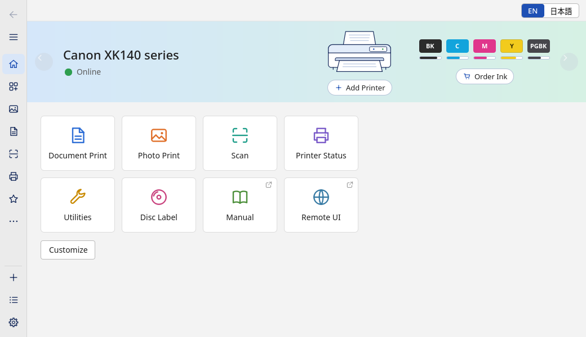
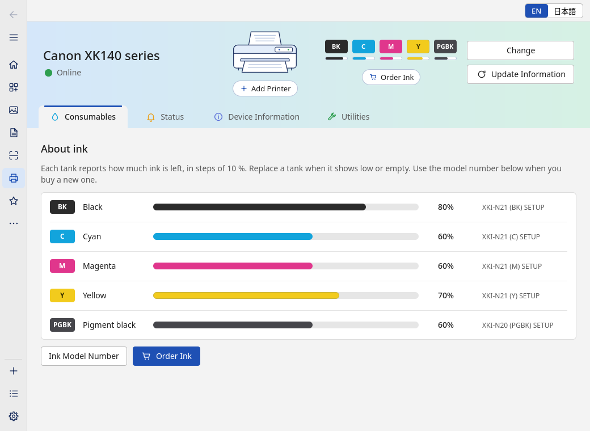
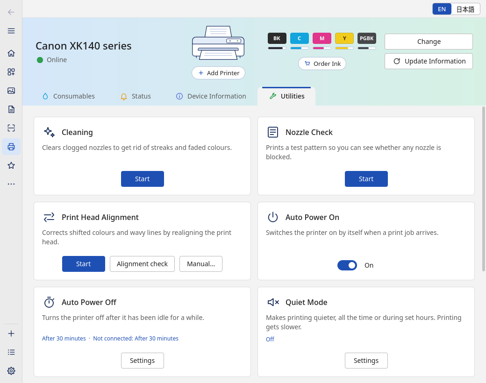
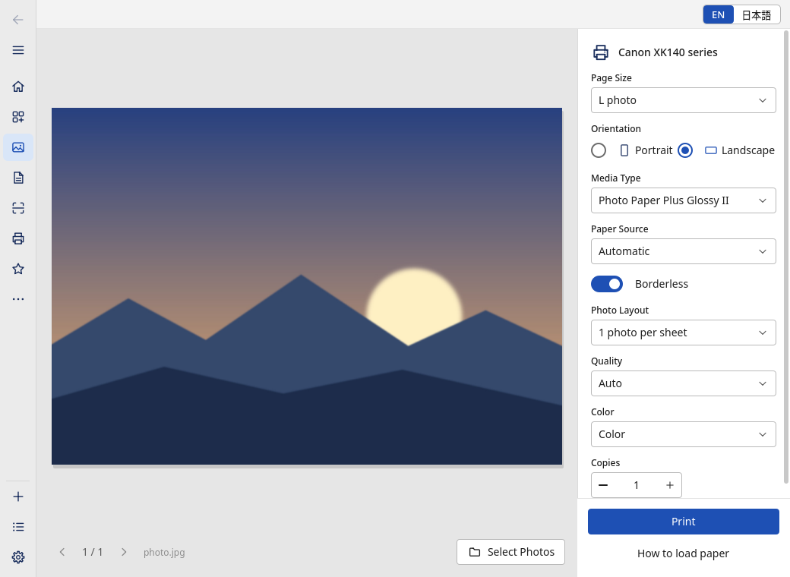
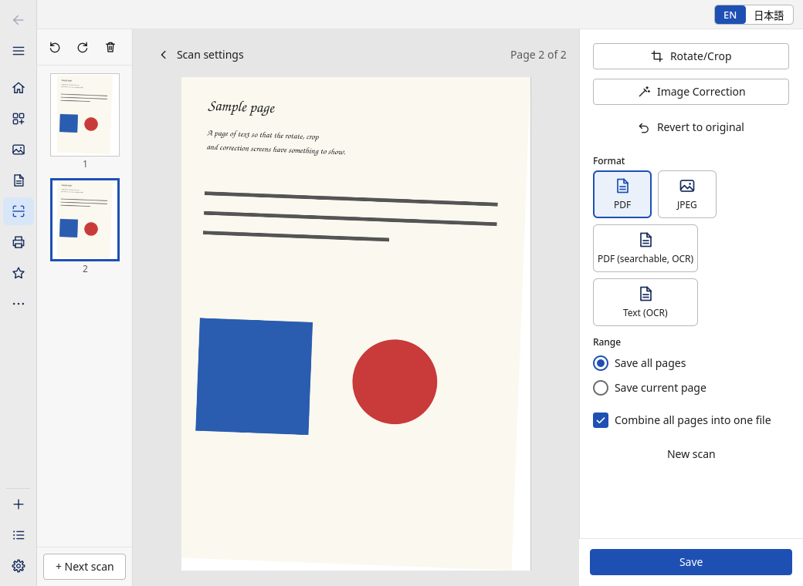
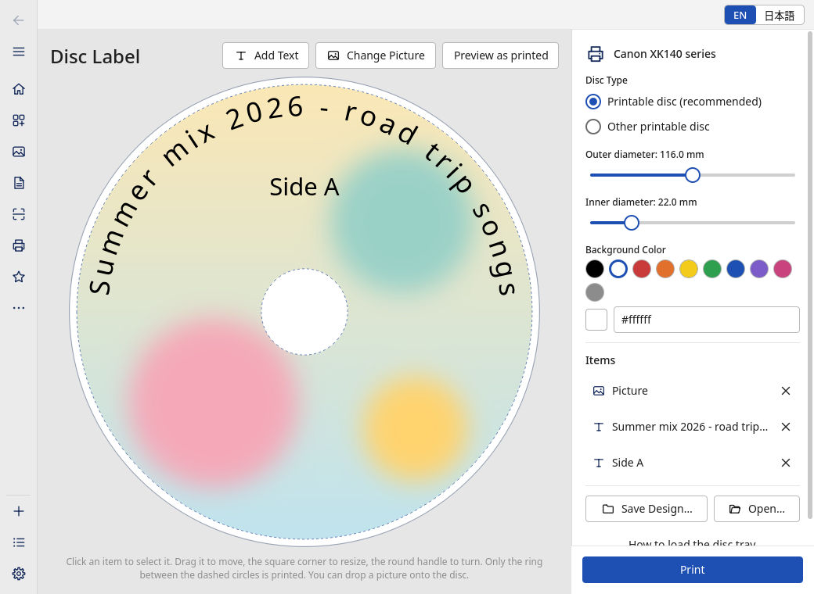

# Washi 和紙

[](https://github.com/Jenari-Dev/washi/actions/workflows/ci.yml)

**English** · [日本語](README.ja.md)

Washi is a Linux app for Canon inkjet printers: printer status and ink levels, maintenance,
settings, photo and document printing, scanning and disc labels. It does what Canon's *Canon PRINT*
app does on other systems, and it needs no Canon driver and no cloud account: it talks to the
printer over your local network.

> **Washi is an independent, unofficial project.** It is not affiliated with, endorsed by or
> sponsored by Canon Inc. Canon, PIXUS, PIXMA and Canon PRINT are trademarks of Canon Inc., used here
> only to say which printers Washi works with. See [NOTICE.md](NOTICE.md).

| | |
|---|---|
|  |  |
|  |  |
|  |  |

<sub>The screenshots are rendered against Washi's fake printer, so names and ink levels are sample
data. The interface is also available in Japanese ([screenshots](README.ja.md)).</sub>

## What it does

- **Status and ink.** Online, sleeping or offline; ink level of every tank with its model number;
  paper in the trays; device information (firmware, connection, page and replacement counters). When
  the printer reports a support code, Washi shows it with a short explanation and a button to its
  help page. A printer in auto power-off is read without waking it.
- **Maintenance.** Cleaning and deep cleaning, nozzle check, print head alignment (automatic,
  check sheet, or entering the values by hand), and roller or bottom plate cleaning on models that
  offer them. Jobs show their progress and can be cancelled.
- **Settings.** Quiet mode (also on a schedule), auto power on and off, ink drying time, paper gap,
  automatic firmware update. Every change is checked against what the printer allows and read
  back afterwards.
- **Printing.** Photos (JPEG, PNG, BMP) with borderless printing, paper type and tray taken from
  the printer's own list, one to sixteen pictures per sheet; PDF documents (and Office files when
  LibreOffice is installed) with page ranges and two-sided printing. A preview shows the sheet as it
  will come out. Files can be dropped onto the page.
- **Scanning.** Documents and photos from the flatbed, several pages in one go, rotate, crop,
  slant correction, colour correction, automatic crop, several photos on one glass, stitching two
  halves of a large original, PDF or JPEG output, and text recognition when Tesseract is installed.
- **Disc labels.** A designer for the printable ring of a disc: picture, texts, background colour,
  text that follows the ring, a preview of what is sent to the printer, and printing from the disc
  tray.
- **Notifications.** A small background service (`washid`) tells you when a tank runs low or empty,
  when the printer reports an error and when it is back online.
- **English and Japanese.** The app, the notifications and the desktop entry, with a language switch
  in the window that takes effect at once.
- **A command-line tool** (`washi`) for the same jobs, with JSON output for scripts.

## Supported printers

| Printer | Status |
|---|---|
| Canon PIXUS XK140, firmware 1.060 | **Verified.** The [table below](#what-has-been-run-on-a-real-printer) says what exactly. |
| Other Canon inkjet printers that advertise `_canon-chmp._tcp` on the network (`washi discover` lists them) | **Untested.** They should behave the same way, and Washi reads each printer's tanks, trays, cleaning types and settings from the printer instead of assuming them, but nobody has tried yet. |

If you have another model, a report is very welcome: the
[printer report](https://github.com/Jenari-Dev/washi/issues/new?template=printer_report.md)
template tells you what to try. Only try writes (cleaning, printing, settings) you are comfortable
with; they use ink and paper.

## Install

### Arch Linux

Download `washi-0.1.0-1-x86_64.pkg.tar.zst` from the
[latest release](https://github.com/Jenari-Dev/washi/releases/latest) and install it:

```
sudo pacman -U washi-0.1.0-1-x86_64.pkg.tar.zst
```

or build the package yourself from the PKGBUILD in this repository:

```
git clone https://github.com/Jenari-Dev/washi.git
cd washi/packaging/arch
makepkg -si
```

Details and the optional dependencies (OCR, Office files, PDF preview) are in
[packaging/arch/README.md](packaging/arch/README.md).

### Flatpak

Download `Washi-0.1.0-x86_64.flatpak` from the
[latest release](https://github.com/Jenari-Dev/washi/releases/latest). It needs the KDE 6.11 runtime
from Flathub:

```
flatpak remote-add --user --if-not-exists flathub https://dl.flathub.org/repo/flathub.flatpakrepo
flatpak install --user Washi-0.1.0-x86_64.flatpak
flatpak run io.github.Jenari_Dev.Washi
```

In the Flatpak, files are chosen through the desktop's file dialog (Washi gets no access to your
home directory), text recognition and Office conversion are not available (the app hides them), and
the command-line tool is `flatpak run --command=washi io.github.Jenari_Dev.Washi status`. The daemon
is started when the app needs it; for notifications while the app is closed, start
`flatpak run --command=washid io.github.Jenari_Dev.Washi` when you log in.

### From source

You need Rust 1.85 or newer, Qt 6 (base, declarative, svg), KDE's KI18n, gettext and a C++
compiler. For PDF printing install poppler (`pdftoppm`); for scan OCR, Tesseract; for Office files,
LibreOffice. On Arch Linux:

```
sudo pacman -S --needed rust base-devel qt6-base qt6-declarative qt6-svg ki18n gettext poppler
git clone https://github.com/Jenari-Dev/washi.git
cd washi
cargo build --release
```

`contrib/install-local.sh` builds and installs everything into `~/.local` (the three programs, the
translation, desktop entry and icon, the user service and D-Bus activation file) and starts the
daemon; `--host HOST` also saves your printer as the default.

## First steps

1. Set the printer up on your network with its own control panel (Wi-Fi or cable), and switch it on.
2. Start **Washi** from the application menu (or run `washi-app`). The app starts its background
   service by itself. Choose *Add Printer*: printers on the network are found automatically, or you
   can type the printer's address.
3. Look around. The status pages only read from the printer. If you want to be sure nothing can be
   written while you explore, start the service yourself with `washid --read-only` first.
4. For desktop notifications while the app is closed, run `systemctl --user enable --now washid`.
5. When you are ready for a first write, run a *Nozzle Check* from *Utilities* (the maintenance job
   that has been tried on real hardware), or print the test page that comes with Washi
   (`/usr/share/doc/washi/testpage.pdf`, or `contrib/testpage.pdf` in the source).

The language switch (`EN | 日本語`) is in the top right corner of every page. Without a saved
choice, Washi starts in Japanese when the session's locale is Japanese and in English otherwise.

## Command line

Reading is always safe; `--json` gives machine-readable output. A printer is chosen with
`--host HOST`, else the one saved with `washi config set-host HOST`, else the first that answers
mDNS.

```
washi discover                    # printers on the network
washi status                      # power, state, ink levels, paper per tray, support code
washi watch                       # follow the printer; a line whenever something changes
washi info                        # model, firmware, counters
washi settings                    # device settings and the values they accept
washi scanner                     # what the scanner offers
washi media                       # the paper the printer offers
washi firmware                    # firmware version, is an update offered
washi tools                       # which optional helper programs are installed
```

Anything that changes the printer, uses ink or paper, or moves the scanner is a **dry run** until
you add `--confirm`: Washi prints exactly what it would send and opens no connection.

```
washi maint nozzle-check --confirm
washi maint clean --deep --confirm
washi maint align --auto --confirm
washi set quiet on --confirm
washi set auto-power-off 30 --confirm
washi scan --size a4 --res 300 --mode color -o scan.pdf --confirm
washi print photo.jpg --size l --borderless --confirm
washi print report.pdf --size a4 --duplex long --confirm
washi disc --image art.png --text "Summer mix" --preview label.png      # renders only
washi power off --confirm
```

The full list of commands and options is in [docs/USAGE.md](docs/USAGE.md) (or `washi --help`).

## Safety model

- **Reading is separate from writing.** The only requests a read command can send are status,
  capability and configuration queries, and the code refuses anything else.
- **Nothing that uses ink or paper, moves the scanner or changes the printer happens without an
  explicit yes.** In the app that is a confirmation dialog; on the command line it is `--confirm`,
  and without it you get a dry run. Inside the program, every such request needs a confirmation
  token that is only created after the user has agreed.
- **`washid --read-only`** refuses every write before it looks at the arguments.
- **Changes are verified.** Settings are checked against what the printer says it accepts, written
  inside the printer's own job, and read back; a mismatch is an error.
- **Left out on purpose:** service counters and their resets, anything about ink authentication,
  and the printer's firmware image. The optional firmware update only asks the printer to run its
  own update, after a strong warning, and is unverified (see the table below).
- **Identifiers stay out.** Serial numbers and hardware addresses in replies are not copied into
  Washi's data, are not logged, and are blanked in `washi raw`.

## What has been run on a real printer

Washi was written against a PIXUS XK140 (firmware 1.060) and everything that only *reads* has been
checked on it. Writes are different: they use ink and paper and cannot be undone, so they were
tried one at a time, and most of them have so far only run against Washi's fake printer (a test
double that speaks the same protocols). Please treat the right-hand column as "should work", and
tell us what you find.

| Area | Verified on the XK140 | Implemented, tested against the fake printer only |
|---|---|---|
| Discovery and printer list | finding the printer by mDNS, status polling | removing a printer from the list, switching between several printers |
| Status and ink | online / sleeping, ink levels and tank models, paper per tray, counters, device information, firmware version and update flag, the printer's web links | support-code messages and notifications for a real error (the printer was never in an error state) |
| Settings | reading every setting and its allowed values | **writing** any of them: quiet mode, auto power on / off, ink drying time, paper gap, automatic firmware update; manual head alignment values |
| Maintenance | **nozzle check** (printed, with progress and completion) | cleaning, deep cleaning, automatic alignment, alignment check, manual alignment sheets; roller and bottom plate cleaning (the XK140 offers neither) |
| Firmware | reading the version and the update flag | the **firmware update** itself |
| Power | **wake** (`washi power on --confirm`, the request the Wake button sends: the printer came out of auto power-off; XK140, firmware 1.060, 2026-10-14) | power off |
| Printing | reading the media list (1335 entries), paper sizes, trays and the disc tray entry; **one PDF page** on plain A4 paper from the cassette, draft quality, black and white | photos and borderless printing, colour, several pictures per sheet, two-sided printing, other paper types and the rear tray |
| Scanning | reading the scanner's capabilities; **one A4 page** at 150 dpi in grey as PDF | colour scans, photo mode, other resolutions, several pages in one session |
| Scan editing, OCR | | rotate, crop, slant, colour correction, auto crop, multi-photo, stitching, OCR (these run on the computer, not on the printer) |
| Disc labels | reading the disc tray entry | printing a label |
| Notifications, English / Japanese interface | | everything (covered by the automated tests and screenshots) |

## What is not included, and why

- **Wi-Fi setup of a new printer ("cableless setup").** The maker's own tool does this with a
  credential that is built into its software. Washi does not contain that credential and never
  will: it would not be right to extract or publish it. Set Wi-Fi up on the printer's control panel
  (or with WPS); Washi finds the printer afterwards. See [NOTICE.md](NOTICE.md).
- **Canon's accounts and cloud services,** subscription features, the chat assistant, the hints and
  creative-content sites, installers for other apps. Washi links to the printer's own web pages
  where that helps, and nothing more.
- **Usage statistics.** Washi sends none (see below).
- **Service-mode operations** such as resetting counters.

## Privacy

Washi has no accounts and no telemetry and sends nothing anywhere. The only network traffic is to
the printer you chose, plus local mDNS discovery. Web pages that the printer points to (ink shop,
manual, help for an error code) open in your browser only after Washi has told you whose page it is
and you have said yes. Caches live in `~/.cache/washi` under a file name that carries no host or
device name, and the daemon never logs host names, serial numbers or hardware addresses.

## Legal

Washi is an independent project. It contains no Canon software, firmware, images, icons, fonts,
screenshots or interface text: the code, the artwork, the wording and the Japanese translation are
original. The printer protocol was documented by observing a printer owned by the author and
analysing lawfully installed software, only to make an independent program work with it, and only
the facts needed for interoperability are published ([docs/PROTOCOL.md](docs/PROTOCOL.md)). Canon's
names are used only to identify printers and paper. The full notice, in English and Japanese, is in
[NOTICE.md](NOTICE.md); if you think something here infringes your rights, please open an issue.

## Documentation

- [docs/USAGE.md](docs/USAGE.md): command-line reference, the desktop app, languages.
- [docs/DBUS-API.md](docs/DBUS-API.md): the daemon, its configuration file and its D-Bus interface.
- [docs/PROTOCOL.md](docs/PROTOCOL.md): the printer protocols (CHMP/IVEC, IPP, eSCL).
- [docs/ARCHITECTURE.md](docs/ARCHITECTURE.md): how the pieces fit together.
- [CONTRIBUTING.md](CONTRIBUTING.md): reporting problems, building, translating.
- [CHANGELOG.md](CHANGELOG.md).

## Development

```
cargo build --release
cargo test --workspace          # needs no printer: it runs against washi-fake
python3 po/check.py             # translations
```

`washi-fake-printer` is a scriptable fake printer on 127.0.0.1 for trying the app without a real
one. [CONTRIBUTING.md](CONTRIBUTING.md) has the rest.

## Licence

GPL-2.0-or-later, see [LICENSE](LICENSE). Some Rust dependencies are licensed under Apache-2.0
only, which is compatible with version 3 of the GPL but not with version 2 alone, so the compiled
binaries we distribute are under the terms of the GPL-3.0-or-later
([LICENSES/GPL-3.0-or-later.txt](LICENSES/GPL-3.0-or-later.txt)). The licences of all dependencies
are in [THIRD-PARTY-LICENSES.md](THIRD-PARTY-LICENSES.md).
